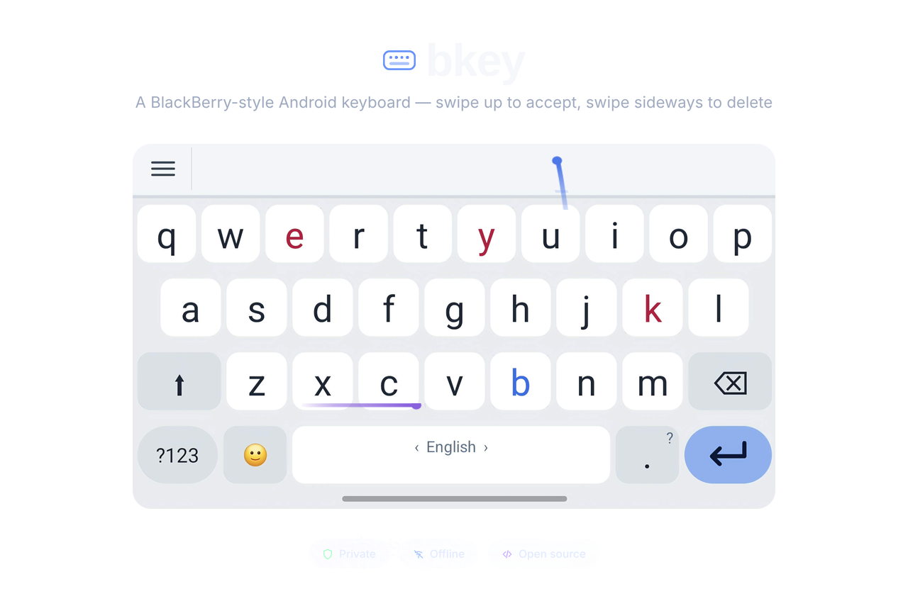
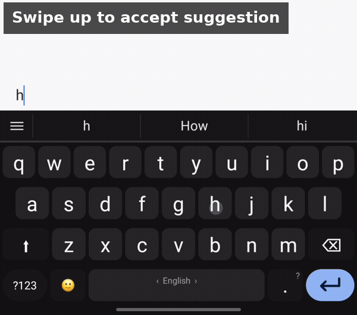
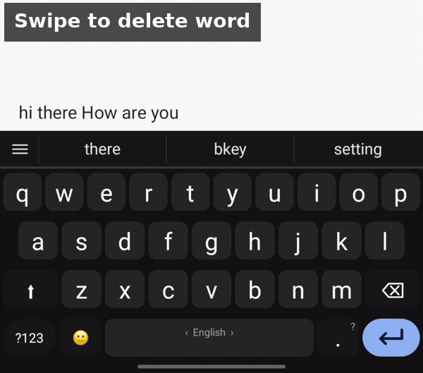
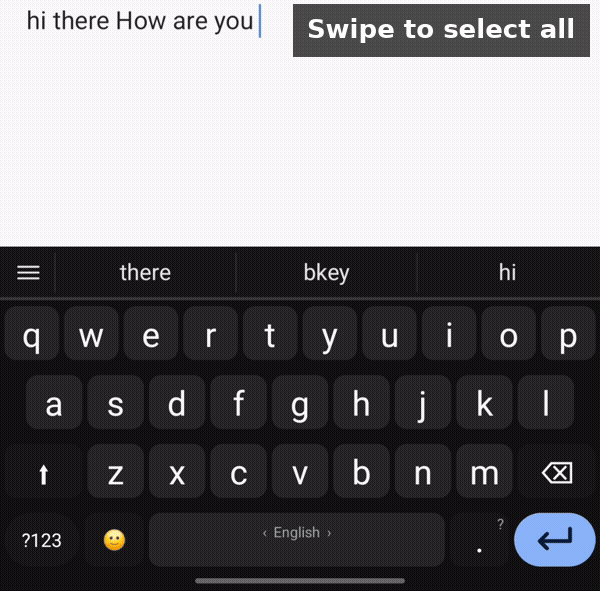
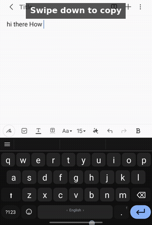
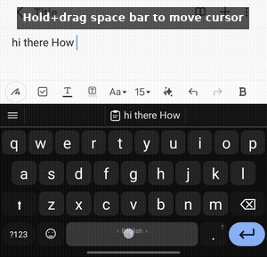
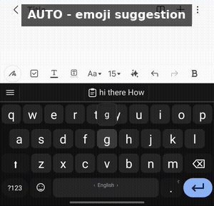
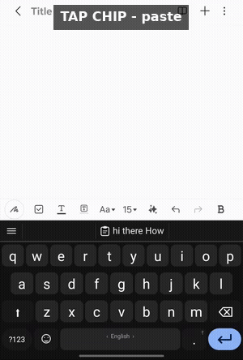

  

# bkey ⌨️

**An Android keyboard built on BlackBerry Keyboard - Classic's swipe gestures — swipe up to pick a suggestion, swipe left to delete.**

---

## 📖 English

**🔗 Quick links:** [Features](#en-features) · [Privacy & security](#en-privacy) · [Download](#en-download) · [FAQ](#en-faq) · [Community & bug reports](#en-community) · [Support](#en-support)

### ✨ Overview

**bkey** is an Android keyboard (IME) built on the swipe gestures of the **BlackBerry Keyboard -
Classic** app, with more customization and extra features: swipe up on any suggestion to accept it
instantly, and swipe left across the letter row for quick deletion instead of repeated backspace
taps. Fully supports Arabic and English with a carefully tailored experience for each.

 

### 🚀 Features

**✋ Gestures**
- Swipe up on any suggestion: accept it instantly.

  
- Swipe sideways over the keys: delete the last whole word at once.

  
- Swipe in the exact opposite direction: select all typed text at once.

  
- Swipe down over the keys: copy selected text — the same gesture turns into paste for one minute
  afterward.

  
- Press-and-hold + drag the space bar: move the cursor character by character.

  
- Swipe the space bar left/right: switch language (Arabic/English) without a separate 🌐 button.
- Long-press any key: popup with alternate characters (diacritics, accented letters...).

 

**⌨️ Smart typing & prediction**
- Silent auto-correct on space, and next-word prediction (up to 3 words).
- On-the-fly word learning as you type, plus a manual trainer that saves a whole sentence instantly.
- **Automatic emoji suggestions** based on the word or sentence context you're typing.

  
- Text shortcuts: type a shortcut (e.g. "omw") and it expands to the full phrase on space.
- Double-tap space for an automatic period + space.
- Auto-capitalize the first letter of each sentence (English).
- Automatic verification-code (OTP) suggestions from SMS or WhatsApp — all processed on-device. *(Plus only)*

 

**📋 Smart clipboard**
- A full clipboard drawer: pin, delete, and auto-delete old items after a duration you choose
  (from 1 hour to 30 days, or never).
- Automatically saves the last screenshot (a single thumbnail that replaces the previous one). *(Plus only)*
- The last copied text shows right in the middle suggestion slot for a quick re-paste.

  

 

**😀 Emoji & GIF**
- Full emoji and symbols panel with a "Recently used" section (clear it all or long-press to
  remove a single emoji).
- The emoji panel's GIF tab is powered by KLIPY GIF — search and preview animated GIFs. *(Plus only)*

 

**🎨 Full customization**
- 3 color themes, 9 key shapes, multiple fonts (System/Tajawal).
- Full size control: key letter size, keyboard height, suggestion bar height, and suggestion
  text size.
- Enter-key color; the floating ABC/Delete capsules match your theme automatically.
- Key-bounce animation and the suggestion-accept flying-word animation — each toggleable on its own.

 

**🔊 Sound & vibration**
- Multiple typing tones + independent swipe/delete tones, each with its own volume level.
- Optional haptic vibration on press and swipe.

 

**⚙️ More preferences**
- A persistent number row above the keyboard (plus a dedicated row shown in password fields even
  when the general one is off).
- Optional Arabic-Indic digits (١٢٣).
- One-handed mode (compact, left or right).
- Voice typing (optional mic button).
- Key-preview popup above the key on touch.
- **Privacy-first**: Incognito mode disables learning and clipboard saving entirely; passwords,
  emails and links are never learned from, even outside Incognito mode.

 

### 🔒 Privacy & security

- **Clean** has no network access at all, and can't read SMS, notifications, photos or storage —
  those permissions aren't even in the app. Voice typing still works (it's handled by your
  device's own speech-recognition service, not by bkey directly).

- **Plus** adds GIF search, image/sticker pasting, verification-code (OTP) suggestions, and the
  in-app updater. OTP suggestions are off by default even in Plus and only read a newly-arrived
  SMS or WhatsApp notification — never your message history — and everything is processed
  on-device, never sent to any server.

> ⚠️ **About the Play Protect warning on Plus**
>
> We tested this directly: internet alone, or photo access alone, installs with no warning — only
> the *combination* of the two triggers Google Play Protect's "Harmful app" flag. GIF search and
> image-pasting need exactly that combination, so Plus can't avoid it without losing them. We've
> filed a false-positive appeal with Google; until that changes anything, this is standard, expected
> behavior for a sideloaded app with these permissions — not malware. Prefer not to see it at all?
> Install Clean instead.

<b>Steps to pause Play Protect scanning, if you still want to install Plus (tap for details)</b>

 

1. Open the **Google Play Store** app.
2. Tap your profile picture, top right.
3. Tap **Play Protect**.
4. Tap the ⚙️ settings icon, top right.
5. Turn off **Scan apps with Play Protect** — a prompt will ask "Pause app scanning instead?", pick **Pause**.
6. Install the Plus APK.
7. Pause turns itself back on automatically after a day, but it's better to turn it back on yourself right after installing (recommended to keep it on for your other apps).

 

### 📥 Download

Two builds — pick the one that fits you:

| | 🟢 Clean (recommended) | 🔵 Plus |
|---|:---:|:---:|
| Installs with no Play Protect warning | ✅ | ⚠️ see note below |
| GIF search & image/sticker pasting | — | ✅ |
| In-app update checker | — | ✅ |
| Verification-code (OTP) suggestions | — | ✅ (optional, off by default) |
| Screenshot-to-clipboard | — | ✅ |
| Copied-text suggestion | ✅ | ✅ |

&nbsp;

**Clean** requests only what a keyboard strictly needs to type (no internet, no photos/storage, no SMS) — nothing else above works here except the copied-text suggestion, since the rest needs internet or photo access. Updates manually from this page only.

**Plus** has everything, but internet and photo access together trigger Google Play Protect's "Harmful app" warning on install (expected, not a real problem — details in [Privacy & security](#en-privacy)). Update it from this page or its in-app updater (Settings → **Update the app**); either way it stays on Plus, never Clean.

 

### ❓ FAQ

<b>Does the keyboard send anything I type to the internet?</b>

 

No, never — all learning, correction and prediction happen locally on your device. See [Privacy & security](#en-privacy) for exactly what Clean and Plus can each access.

 

<b>Why does Google Play Protect warn me when I install Plus?</b>

 

Because Plus needs internet and photo access together, and Google flags that exact combination for sideloaded apps — confirmed by our own testing, not a guess. Standard behavior, not malware. Install Clean to skip the warning entirely, or see [Privacy & security](#en-privacy) to pause it temporarily.

 

<b>Where are my learned words stored, and how do I wipe them?</b>

 

They're stored locally on your device only. In the app's settings, under the predictions-training section, the **"Clear all learned words"** button wipes them instantly.

 

<b>Does it use a lot of battery or memory?</b>

 

No — it's lightweight and runs fully on-device, with no background cloud processing.

 

### 🤝 Community & bug reports

- **Ran into a bug or crash?** Settings → **Error log** → **"📧 Email developer"** opens your mail app with the error details, sent straight to **lvl60me@gmail.com**.
- You can email the same address with suggestions, feature ideas, or general feedback.
- Emailing directly is the only way to reach the developer.

 

### 📩 Support

If you like the project and want to support it, you can buy me a coffee on Ko-fi:

---

## 📖 العربية

**🔗 اختصارات سريعة:** [المميزات](#ar-features) · [الخصوصية والأمان](#ar-privacy) · [التحميل](#ar-download) · [الأسئلة الشائعة](#ar-faq) · [المجتمع والإبلاغ عن الأخطاء](#ar-community) · [الدعم](#ar-support)

### ✨ الوصف

**bkey** كيبورد أندرويد (IME) مبني على إيماءات السحب في تطبيق **BlackBerry Keyboard - Classic**،
بتخصيص ومميزات أكثر: اسحب للأعلى من أي اقتراح لاختياره فوراً، واسحب لليسار على صف الحروف للحذف
بدل الضغط المتكرر على الباكسبيس. يدعم العربية والإنجليزية بالكامل مع تجربة مخصصة بعناية لكل لغة.

 

### 🚀 المميزات

**✋ الإيماءات (Gestures)**
‏• سحب للأعلى من أي اقتراح: قبوله فوراً‏.

‏• سحب أفقي فوق الحروف: حذف آخر كلمة كاملة دفعة واحدة‏.

‏• سحب بالاتجاه المعاكس تماماً: تحديد كل النص المكتوب دفعة واحدة‏.

‏• سحب للأسفل فوق الحروف: نسخ النص المحدد، وتتحول نفس السحبة تلقائياً للصق لمدة دقيقة بعد النسخ‏.

‏• ضغط مطوّل + سحب على زر المسافة: تحريك المؤشر حرفاً حرفاً‏.

‏• سحب زر المسافة يميناً/يساراً: تبديل اللغة (عربي/إنجليزي) بدون زر 🌐 منفصل‏.  
‏• ضغط مطوّل على أي حرف: بوب أب الحروف البديلة (حركات، حروف أجنبية...)‏.

 

**⌨️ الكتابة والتوقع الذكي**
‏• تصحيح تلقائي صامت عند المسافة، وتوقع الكلمة التالية (حتى 3 كلمات)‏.  
‏• تعلّم الكلمات الجديدة أثناء الكتابة تلقائياً + مدرّب يدوي يحفظ جملة كاملة فوراً‏.  
‏• **اقتراح إيموجي تلقائي** حسب الكلمة أو سياق الجملة المكتوبة‏.

‏• اختصارات نصية: اكتب اختصار (مثل "سع") ويتحول تلقائياً لعبارة كاملة عند المسافة‏.  
‏• نقطة ومسافة تلقائية بضغطتين متتاليتين على زر المسافة‏.  
‏• أحرف كبيرة تلقائياً في بداية كل جملة (بالإنجليزي)‏.  
‏• اقتراح أكواد التحقق (OTP) تلقائياً من الرسائل أو واتساب — كل المعالجة محلية على الجهاز *(نسخة بلس فقط)*‏.

 

**📋 الحافظة الذكية**
‏• درج حافظة كامل: تثبيت، حذف، وحذف تلقائي للعناصر القديمة بعد مدة تختارها (من ساعة إلى 30 يوماً، أو بدون حذف)‏.  
‏• حفظ آخر لقطة شاشة تلقائياً (مصغّرة واحدة تحل محل القديمة) *(نسخة بلس فقط)*‏.  
‏• آخر نص منسوخ يظهر مباشرة بمنتصف شريط الاقتراحات لإعادة لصقه بسرعة‏.

 

**😀 إيموجي و GIF**
‏• لوحة إيموجي ورموز كاملة، مع قسم "مستخدم حديثاً" (قابل للحذف أو حذف عنصر واحد بالضغط المطول)‏.  
‏• تبويب GIF في لوحة الإيموجي مدعوم بـ KLIPY GIF — بحث ومعاينة صور GIF متحركة *(نسخة بلس فقط)*‏.

 

**🎨 التخصيص الكامل**
‏• 3 ثيمات ألوان، 9 أشكال لأزرار الكيبورد، خطوط متعددة (افتراضي/Tajawal)‏.  
‏• تحكم كامل بالحجم: حجم حروف المفاتيح، ارتفاع الكيبورد، ارتفاع شريط الاقتراحات، وحجم خط الاقتراحات‏.  
‏• لون زر الإدخال؛ كبسولات أبجد/الحذف العائمة تتبع لون الثيم تلقائياً‏.  
‏• أنميشن ارتداد المفاتيح وأنميشن طيران الكلمة عند القبول — كل منهما قابل للإيقاف لحاله‏.

 

**🔊 الصوت والاهتزاز**
‏• نغمات كتابة متعددة + نغمات مستقلة للسحب والحذف، كل مجموعة بمستوى صوت خاص بها‏.  
‏• اهتزاز لمسي اختياري عند الضغط والسحب‏.

 

**⚙️ تفضيلات إضافية**
‏• صف أرقام دائم فوق الكيبورد (مع صف مخصص يظهر بحقول كلمات المرور حتى لو كان الصف العام مطفياً)‏.  
‏• أرقام عربية هندية (١٢٣) اختيارية‏.  
‏• وضع اليد الواحدة (مصغّر يمين أو يسار)‏.  
‏• كتابة بالصوت (زر مايكروفون اختياري)‏.  
‏• بوب أب معاينة الحرف فوق الزر عند اللمس‏.  
‏• **خصوصية أولاً**: وضع تخفي (Incognito) يوقف التعلّم والحفظ بالحافظة بالكامل، وكلمات المرور/الإيميلات/الروابط
  لا يُتعلَّم منها مطلقاً حتى في الوضع العادي.

 

### 🔒 الخصوصية والأمان

‏• **النسخة النظيفة (Clean)** ما فيها أي اتصال إنترنت إطلاقاً، وما تقدر تقرأ رسائل ولا إشعارات ولا
  صور ولا تخزين — هذي الصلاحيات غير موجودة بالتطبيق أصلاً. الكتابة بالصوت تشتغل برضه (تمر عبر
  خدمة التعرف على الصوت بجهازك، مو عبر bkey مباشرة).

‏• **نسخة بلس** فيها إضافة بحث GIF، لصق الصور/الستيكرات، اقتراح رمز التحقق (OTP)، والتحديث
  التلقائي من داخل التطبيق. اقتراح OTP معطّل افتراضياً حتى في بلس، ويفحص بس الرسالة أو إشعار
  واتساب الجديد اللحظي — أبداً صندوق الرسائل القديم — وكل المعالجة على الجهاز فقط.

> ⚠️ **ملاحظة عن تحذير Play Protect بنسخة بلس**
>
> جربنا بأنفسنا: نسخة فيها الإنترنت بس، أو الصور بس، تثبت بدون تحذير — بس **جمع صلاحية الإنترنت
> مع الصور/التخزين** هو اللي يخلي Google Play Protect يصنفها "Harmful app". وهذي بالضبط التركيبة
> اللي يحتاجها بحث GIF ولصق الصور، فبلس ما تقدر تتجنب التحذير بدون ما تفقد الميزتين. قدّمنا استئناف
> رسمي لجوجل بهذا التصنيف الخاطئ؛ لحد الآن هذا سلوك متوقع وقياسي لأي تطبيق مُثبّت من خارج المتجر
> بهذي الصلاحيات، مو فيروس أو مشكلة حقيقية. ما تبي تشوفه؟ ثبّت النظيفة بدالها.

<b>خطوات تعليق فحص Play Protect، لو تبي تثبت بلس برضه (اضغط للتفصيل)</b>

 

‏1. افتح تطبيق **متجر Google Play**.  
‏2. اضغط صورة حسابك بأعلى يمين الشاشة.  
‏3. اختر **Play Protect**.  
‏4. اضغط أيقونة الإعدادات ⚙️ بأعلى يمين الشاشة.  
‏5. أوقف خيار **Scan apps with Play Protect** — رح تطلع لك رسالة تسألك «Pause app scanning instead?»، اختر **Pause**.  
‏6. ثبّت ملف بلس.  
‏7. خيار Pause يرجع يشتغل لوحده تلقائياً بعد يوم، لكن الأفضل ترجّعه بنفسك فوراً بعد التثبيت (يفضّل يضل شغّال دايماً لباقي تطبيقاتك).

 

### 📥 التحميل

نسختين — اختر اللي تناسبك:

| | 🟢 النظيفة (موصى بها) | 🔵 بلس |
|---|:---:|:---:|
| تتثبت بدون أي تحذير من Play Protect | ✅ | ⚠️ شوف الملاحظة تحت |
| بحث GIF ولصق الصور/الستيكرات | — | ✅ |
| تحديث تلقائي من داخل التطبيق | — | ✅ |
| اقتراح رمز التحقق (OTP) | — | ✅ (اختياري، معطّل افتراضياً) |
| حفظ لقطة الشاشة بالحافظة | — | ✅ |
| اقتراح آخر نص منسوخ | ✅ | ✅ |

&nbsp;

**النظيفة** ما تطلب إلا أقل صلاحيات يحتاجها أي كيبورد للكتابة فقط (بدون إنترنت، بدون صور/تخزين، بدون رسائل) — كل ميزات الجدول فوق غير متوفرة فيها إلا اقتراح النص المنسوخ، لأن الباقي يحتاج إنترنت أو صلاحية صور. تحديثها يدوي بس من هذي الصفحة.

**بلس** فيها كل شي، بس جمع الإنترنت مع صلاحية الصور يسبب تحذير "Harmful app" من Google Play Protect عند التثبيت (متوقع، مو مشكلة حقيقية — التفاصيل بقسم [الخصوصية والأمان](#ar-privacy)). حدّثها من هذي الصفحة أو من داخل التطبيق (الإعدادات ← **تحديث التطبيق**) — بالحالتين تضل بلس، ما تتحول للنظيفة.

 

### ❓ الأسئلة الشائعة

<b>هل الكيبورد يرسل أي بيانات أو كلمات أكتبها للإنترنت؟</b>

 

لا إطلاقاً — كل التعلّم والتصحيح والتوقع يصير محلياً على جهازك. شوف [الخصوصية والأمان](#ar-privacy) لتفاصيل اللي تقدر النظيفة وبلس يوصلون له بالضبط.

 

<b>ليش قوقل بروتكت يحذّرني عند تثبيت نسخة بلس؟</b>

 

لأن بلس تحتاج الإنترنت وصلاحية الصور مع بعض، وقوقل يصنّف هذي التركيبة بالذات لأي تطبيق يُثبّت من خارج المتجر — تأكدنا بالتجربة، مو تخمين. سلوك قياسي ومو فيروس. ثبّت النظيفة لتتجنب التحذير خالص، أو شوف [الخصوصية والأمان](#ar-privacy) لتعليقه مؤقتاً.

 

<b>وين تتحفظ الكلمات اللي يتعلمها الكيبورد، وكيف أمسحها؟</b>

 

تنحفظ محلياً على جهازك فقط. من إعدادات التطبيق قسم تدريب التوقعات، زر **"مسح جميع الكلمات المتعلمة"** يمسحها كلها فوراً.

 

<b>هل يستهلك الكيبورد بطارية أو ذاكرة كثير؟</b>

 

لا — خفيف ويشتغل بالكامل محلياً بدون أي معالجة بالسحابة.

 

### 🤝 المجتمع والإبلاغ عن الأخطاء

‏• **واجهت خطأ أو تعطّل بالتطبيق؟** من الإعدادات ← **سجل الأخطاء** ← **"📧 إرسال للمطوّر"**، وبيفتح تطبيق الإيميل عندك جاهز برسالة فيها تفاصيل الخطأ، مرسلة مباشرة لـ **lvl60me@gmail.com**.  
‏• تقدر ترسل لنفس الإيميل أي اقتراح، فكرة ميزة جديدة، أو ملاحظة عامة عن التطبيق.  
‏• التواصل المباشر عبر الإيميل هو الطريقة الوحيدة للتبليغ أو التواصل مع المطوّر.

 

### 📩 الدعم

إذا عجبك المشروع وتبي تدعمه، تقدر تدعمني عبر Ko-fi:

---

Made with ❤️ — bkey

