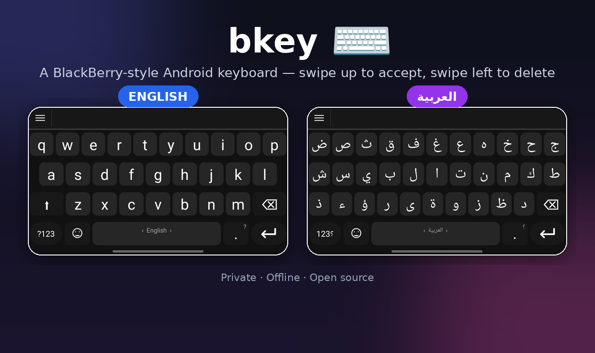
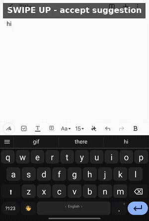
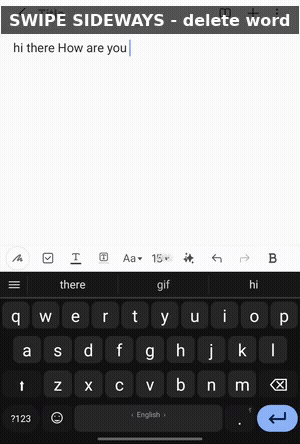
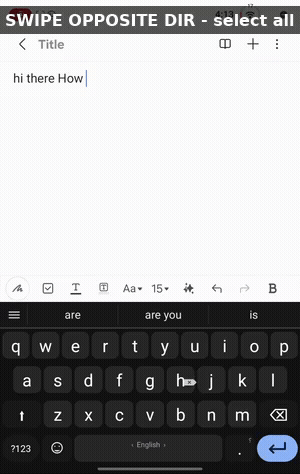
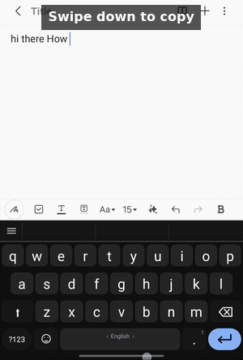
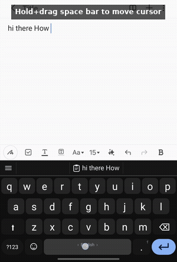
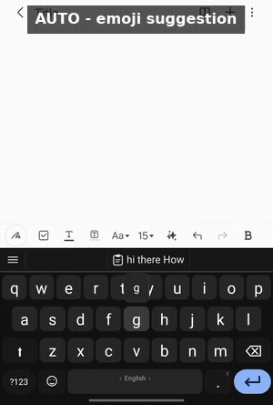
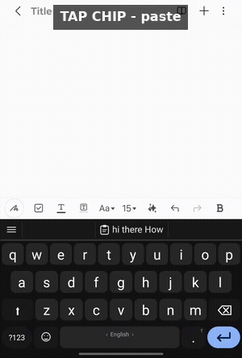

  

# bkey ⌨️

**A BlackBerry-style Android keyboard — swipe up to pick a suggestion, swipe left to delete.**

---

## 📖 English

**🔗 Quick links:** [Features](#en-features) · [Privacy & security](#en-privacy) · [Download](#en-download) · [FAQ](#en-faq) · [Community & bug reports](#en-community) · [Support](#en-support)

### ✨ Overview

**bkey** is an Android keyboard (IME) inspired by the classic BlackBerry physical keyboard, with a
modern gesture twist: swipe up on any suggestion to accept it instantly, and swipe left across the
letter row for quick deletion instead of repeated backspace taps. Fully supports Arabic and English
with a carefully tailored experience for each.

 

### 🚀 Features

**✋ Gestures**
- Swipe up on any suggestion: accept it instantly.

  
- Swipe sideways over the keys: delete the last whole word at once.

  
- Swipe in the exact opposite direction: select all typed text at once.

  
- Swipe down over the keys: copy selected text — the same gesture turns into paste for one minute
  afterward.

  
- Press-and-hold + drag the space bar: move the cursor character by character.

  
- Swipe the space bar left/right: switch language (Arabic/English) without a separate 🌐 button.
- Long-press any key: popup with alternate characters (diacritics, accented letters...).

 

**⌨️ Smart typing & prediction**
- Silent auto-correct on space, and next-word prediction (up to 3 words).
- On-the-fly word learning as you type, plus a manual trainer that saves a whole sentence instantly.
- **Automatic emoji suggestions** based on the word or sentence context you're typing.

  
- Text shortcuts: type a shortcut (e.g. "omw") and it expands to the full phrase on space.
- Double-tap space for an automatic period + space.
- Auto-capitalize the first letter of each sentence (English).
- Automatic verification-code (OTP) suggestions from SMS or WhatsApp — all processed on-device.

 

**📋 Smart clipboard**
- A full clipboard drawer: pin, delete, and auto-delete old items after a duration you choose
  (from 1 hour to 30 days, or never).
- Automatically saves the last screenshot (a single thumbnail that replaces the previous one).
- The last copied text shows right in the middle suggestion slot for a quick re-paste.

  

 

**😀 Emoji & GIF**
- Full emoji and symbols panel with a "Recently used" section (clear it all or long-press to
  remove a single emoji).
- The emoji panel's GIF tab is powered by KLIPY GIF — search and preview animated GIFs.

 

**🎨 Full customization**
- 3 color themes, 9 key shapes, multiple fonts (System/Tajawal).
- Full size control: key letter size, keyboard height, suggestion bar height, and suggestion
  text size.
- Enter-key color, plus color and opacity for the floating capsules in the symbols/clipboard panels.
- Key-bounce animation and the suggestion-accept flying-word animation — each toggleable on its own.

 

**🔊 Sound & vibration**
- 5 typing tones + 5 independent swipe/delete tones, each with its own volume level.
- Optional haptic vibration on press and swipe.

 

**⚙️ More preferences**
- A persistent number row above the keyboard (plus a dedicated row shown in password fields even
  when the general one is off).
- Optional Arabic-Indic digits (١٢٣).
- One-handed mode (compact, left or right).
- Voice typing (optional mic button).
- Key-preview popup above the key on touch.
- **Privacy-first**: Incognito mode disables learning and clipboard saving entirely; passwords,
  emails and links are never learned from, even outside Incognito mode.

 

### 🔒 Privacy & security

- No network access except for the GIF (KLIPY) and voice-typing features, and both are **fully
  optional** — you can simply never use them, and the keyboard runs with zero internet connection
  at all.
- Verification-code (OTP) suggestions **don't exist at all** in the base install — no SMS or
  notification permission whatsoever, and the keyboard can't read any message. It's only added if
  you specifically ask for it and download its update from inside the app, and even then everything
  is processed on-device only, never sent to any server.

 

### 📥 Download

You can update either from inside the app (Settings → **Update the app**) or by tapping the button above again. The in-app button knows whether your current install has OTP turned on or not, and gets you the latest version of the same one. The button above on this page always gives you the plain version without OTP — so if you use it again later and you want OTP, just turn it back on from Settings afterward.

If you want the OTP feature, turn it on from inside the app: Settings → **Suggestions & learning** → scroll down to **Verification code (OTP) suggestions** — that screen explains it and has a button to turn it on.

> ⚠️ **About the OTP feature**
>
> Turning this on needs an update that adds SMS-read and WhatsApp-notification access. Because of those two specific permissions, Google Play Protect blocks installing that update automatically with a warning screen. This is standard Google behavior for any app installed outside the Play Store that requests these permissions — not a bug or malware flag.
>
> If you want the feature, turn off Play Protect scanning, then turn it on from inside the app itself (Settings → Suggestions & learning → Verification code (OTP) suggestions → the button there):
>
> If you ever update the app from this GitHub page instead of the in-app button, just turn the feature back on from that same screen.

<b>Steps to pause Play Protect scanning (tap for details)</b>

 

1. Open the **Google Play Store** app.
2. Tap your profile picture, top right.
3. Tap **Play Protect**.
4. Tap the ⚙️ settings icon, top right.
5. Turn off **Scan apps with Play Protect** — a prompt will ask "Pause app scanning instead?", pick **Pause**.
6. Go back to the OTP screen in the app, tap the download button, and install it.
7. Pause turns itself back on automatically after a day, but it's better to turn it back on yourself right after the update (recommended to keep it on for your other apps).

 

### ❓ FAQ

<b>Does the keyboard send anything I type to the internet?</b>

 

No, never. All learning, correction and prediction happen locally on your device. The only network access is for the optional GIF and voice-typing features, and you can turn both off and run the keyboard with zero internet connection at all. Details in [Privacy & security](#en-privacy).

 

<b>Why does Google Play Protect warn me when I download the OTP update?</b>

 

Because that update adds SMS-read and notification-access permissions, and Google automatically blocks any app installed outside the Play Store that requests those specific permissions — standard behavior, not malware. Steps to pause the warning temporarily are in the [Download](#en-download) section.

 

<b>Where are my learned words stored, and how do I wipe them?</b>

 

They're stored locally on your device only. In the app's settings, under the predictions-training section, the **"Clear all learned words"** button wipes them instantly.

 

<b>Does it use a lot of battery or memory?</b>

 

No, the keyboard is lightweight and runs fully on-device. Only the GIF and voice-typing features use the network, and only while you're actively using them — otherwise there's zero network activity.

 

### 🤝 Community & bug reports

- **Ran into a bug or crash?** Settings → **Error log** → **"📧 Email developer"** opens your mail app with the error details, sent straight to **lvl60me@gmail.com**.
- You can email the same address with suggestions, feature ideas, or general feedback.
- The repo is currently private, so emailing directly is the only way to reach the developer.

 

### 📩 Support

If you like the project and want to support it, you can send a tip via PayPal:

**[💛 Support the project on PayPal](https://paypal.me/algahmdi)**

---

## 📖 العربية

**🔗 اختصارات سريعة:** [المميزات](#ar-features) · [الخصوصية والأمان](#ar-privacy) · [التحميل](#ar-download) · [الأسئلة الشائعة](#ar-faq) · [المجتمع والإبلاغ عن الأخطاء](#ar-community) · [الدعم](#ar-support)

### ✨ الوصف

**bkey** كيبورد أندرويد (IME) مستوحى من أزرار بلاك بيري الفيزيائية الكلاسيكية، لكن بتفاعل حديث:
اسحب للأعلى من أي اقتراح لاختياره فوراً، واسحب لليسار على صف الحروف للحذف بدل الضغط المتكرر
على الباكسبيس. يدعم العربية والإنجليزية بالكامل مع تجربة مخصصة بعناية لكل لغة.

 

### 🚀 المميزات

**✋ الإيماءات (Gestures)**
‏• سحب للأعلى من أي اقتراح: قبوله فوراً‏.

‏• سحب أفقي فوق الحروف: حذف آخر كلمة كاملة دفعة واحدة‏.

‏• سحب بالاتجاه المعاكس تماماً: تحديد كل النص المكتوب دفعة واحدة‏.

‏• سحب للأسفل فوق الحروف: نسخ النص المحدد، وتتحول نفس السحبة تلقائياً للصق لمدة دقيقة بعد النسخ‏.

‏• ضغط مطوّل + سحب على زر المسافة: تحريك المؤشر حرفاً حرفاً‏.

‏• سحب زر المسافة يميناً/يساراً: تبديل اللغة (عربي/إنجليزي) بدون زر 🌐 منفصل‏.  
‏• ضغط مطوّل على أي حرف: بوب أب الحروف البديلة (حركات، حروف أجنبية...)‏.

 

**⌨️ الكتابة والتوقع الذكي**
‏• تصحيح تلقائي صامت عند المسافة، وتوقع الكلمة التالية (حتى 3 كلمات)‏.  
‏• تعلّم الكلمات الجديدة أثناء الكتابة تلقائياً + مدرّب يدوي يحفظ جملة كاملة فوراً‏.  
‏• **اقتراح إيموجي تلقائي** حسب الكلمة أو سياق الجملة المكتوبة‏.

‏• اختصارات نصية: اكتب اختصار (مثل "سع") ويتحول تلقائياً لعبارة كاملة عند المسافة‏.  
‏• نقطة ومسافة تلقائية بضغطتين متتاليتين على زر المسافة‏.  
‏• أحرف كبيرة تلقائياً في بداية كل جملة (بالإنجليزي)‏.  
‏• اقتراح أكواد التحقق (OTP) تلقائياً من الرسائل أو واتساب — كل المعالجة محلية على الجهاز‏.

 

**📋 الحافظة الذكية**
‏• درج حافظة كامل: تثبيت، حذف، وحذف تلقائي للعناصر القديمة بعد مدة تختارها (من ساعة إلى 30 يوماً، أو بدون حذف)‏.  
‏• حفظ آخر لقطة شاشة تلقائياً (مصغّرة واحدة تحل محل القديمة)‏.  
‏• آخر نص منسوخ يظهر مباشرة بمنتصف شريط الاقتراحات لإعادة لصقه بسرعة‏.

 

**😀 إيموجي و GIF**
‏• لوحة إيموجي ورموز كاملة، مع قسم "مستخدم حديثاً" (قابل للحذف أو حذف عنصر واحد بالضغط المطول)‏.  
‏• تبويب GIF في لوحة الإيموجي مدعوم بـ KLIPY GIF — بحث ومعاينة صور GIF متحركة‏.

 

**🎨 التخصيص الكامل**
‏• 3 ثيمات ألوان، 9 أشكال لأزرار الكيبورد، خطوط متعددة (افتراضي/Tajawal)‏.  
‏• تحكم كامل بالحجم: حجم حروف المفاتيح، ارتفاع الكيبورد، ارتفاع شريط الاقتراحات، وحجم خط الاقتراحات‏.  
‏• لون زر الإدخال، ولون وشفافية الكبسولات العائمة بنافذتي الرموز والحافظة‏.  
‏• أنميشن ارتداد المفاتيح وأنميشن طيران الكلمة عند القبول — كل منهما قابل للإيقاف لحاله‏.

 

**🔊 الصوت والاهتزاز**
‏• 5 نغمات للكتابة + 5 نغمات مستقلة للسحب والحذف، كل مجموعة بمستوى صوت خاص بها‏.  
‏• اهتزاز لمسي اختياري عند الضغط والسحب‏.

 

**⚙️ تفضيلات إضافية**
‏• صف أرقام دائم فوق الكيبورد (مع صف مخصص يظهر بحقول كلمات المرور حتى لو كان الصف العام مطفياً)‏.  
‏• أرقام عربية هندية (١٢٣) اختيارية‏.  
‏• وضع اليد الواحدة (مصغّر يمين أو يسار)‏.  
‏• كتابة بالصوت (زر مايكروفون اختياري)‏.  
‏• بوب أب معاينة الحرف فوق الزر عند اللمس‏.  
‏• **خصوصية أولاً**: وضع تخفي (Incognito) يوقف التعلّم والحفظ بالحافظة بالكامل، وكلمات المرور/الإيميلات/الروابط
  لا يُتعلَّم منها مطلقاً حتى في الوضع العادي.

 

### 🔒 الخصوصية والأمان

‏• لا يوجد اتصال بالإنترنت إلا لميزتي GIF (KLIPY) والكتابة بالصوت، وكلاهما **اختياري بالكامل** —
  تقدر ما تستخدمهما إطلاقاً، ويبقى الكيبورد شغّال بدون أي اتصال بالإنترنت نهائياً.
‏• اقتراح أكواد التحقق (OTP) **غير موجودة أصلاً** بالتثبيت الأساسي — ما فيه صلاحية رسائل ولا إشعارات إطلاقاً،
  والكيبورد ما يقدر يقرأ أي رسالة نهائياً. تضاف فقط إذا المستخدم نفسه طلبها ونزّل تحديثها من داخل التطبيق،
  وحتى بعدها كل المعالجة على الجهاز فقط ولا تُرسل لأي سيرفر خارجي.

 

### 📥 التحميل

تقدر تحدّث إما من داخل التطبيق (الإعدادات ← **تحديث التطبيق**) أو بالضغط على الزر بالأعلى من جديد. زر التطبيق يعرف إذا كانت نسختك الحالية مفعّل فيها OTP أو لا، ويجيبلك آخر إصدار من نفس النوع تلقائياً. أما الزر بالأعلى بهذي الصفحة فدايماً يجيب النسخة العادية بدون OTP — فإذا استخدمته مرة ثانية بعدين وتبي OTP، بس فعّلها من جديد من الإعدادات.

إذا احتجت ميزة رمز التحقق، تقدر تفعّلها من داخل التطبيق: الإعدادات ← **التصحيح والاقتراحات والتعلّم** ← انزل لتحت لين تلقى **اقتراح رمز التحقق (OTP)**، وهناك شرح وزر لتفعيلها.

> ⚠️ **ملاحظة عن ميزة رمز التحقق (OTP)**
>
> تفعيل هذي الميزة يحتاج تحديثاً يضيف صلاحية قراءة الرسائل وصلاحية الوصول للإشعارات. بسبب هاتين الصلاحيتين بالذات، نظام حماية قوقل يوقف تثبيت التحديث تلقائياً برسالة تحذيرية. هذا سلوك قياسي من قوقل لأي تطبيق يُحمّل من خارج المتجر ويطلب هذي الصلاحيات، وليس عيباً ولا فيروساً بالتطبيق.
>
> إذا تبي الميزة، عطّل فحص الحماية مؤقتاً ثم فعّلها من داخل التطبيق نفسه (الإعدادات ← التصحيح والاقتراحات والتعلّم ← اقتراح رمز التحقق (OTP) ← الزر هناك):
>
> إذا صار وحدّثت التطبيق من صفحة GitHub هذي بدل الزر اللي بالتطبيق، بس فعّل الميزة من نفس الشاشة مرة ثانية.

<b>خطوات تعليق فحص Play Protect (اضغط للتفصيل)</b>

 

‏1. افتح تطبيق **متجر Google Play**.  
‏2. اضغط صورة حسابك بأعلى يمين الشاشة.  
‏3. اختر **Play Protect**.  
‏4. اضغط أيقونة الإعدادات ⚙️ بأعلى يمين الشاشة.  
‏5. أوقف خيار **Scan apps with Play Protect** — رح تطلع لك رسالة تسألك «Pause app scanning instead?»، اختر **Pause**.  
‏6. ارجع لشاشة OTP داخل التطبيق واضغط زر تحميل التحديث، وثبّته.  
‏7. خيار Pause يرجع يشتغل لوحده تلقائياً بعد يوم، لكن الأفضل ترجّعه بنفسك فوراً بعد التحديث (يفضّل يضل شغّال دايماً لباقي تطبيقاتك).

 

### ❓ الأسئلة الشائعة

<b>هل الكيبورد يرسل أي بيانات أو كلمات أكتبها للإنترنت؟</b>

 

لا إطلاقاً. كل التعلّم والتصحيح والتوقع يصير محلياً على جهازك فقط. الاتصال بالإنترنت الوحيد هو لميزتي GIF والكتابة بالصوت الاختياريتين، وتقدر توقفهما وتستخدم الكيبورد بدون أي اتصال نهائياً. التفاصيل بقسم [الخصوصية والأمان](#ar-privacy).

 

<b>ليش قوقل بروتكت يحذّرني عند تحميل تحديث ميزة OTP؟</b>

 

لأن التحديث يضيف صلاحية قراءة الرسائل وصلاحية الوصول للإشعارات، وقوقل توقف تلقائياً أي تطبيق من خارج المتجر يطلب هذي الصلاحيات بالذات — سلوك قياسي ومو فيروس. خطوات تعليق التحذير مؤقتاً موجودة بقسم [التحميل](#ar-download).

 

<b>وين تتحفظ الكلمات اللي يتعلمها الكيبورد، وكيف أمسحها؟</b>

 

تنحفظ محلياً على جهازك فقط. من إعدادات التطبيق قسم تدريب التوقعات، زر **"مسح جميع الكلمات المتعلمة"** يمسحها كلها فوراً.

 

<b>هل يستهلك الكيبورد بطارية أو ذاكرة كثير؟</b>

 

لا، الكيبورد خفيف ويشتغل محلياً بدون أي معالجة بالسحابة. ميزتي GIF والكتابة بالصوت فقط هما اللي يحتاجون إنترنت وقت استخدامهم الفعلي، وباقي الوقت ما فيه أي نشاط شبكة.

 

### 🤝 المجتمع والإبلاغ عن الأخطاء

‏• **واجهت خطأ أو تعطّل بالتطبيق؟** من الإعدادات ← **سجل الأخطاء** ← **"📧 إرسال للمطوّر"**، وبيفتح تطبيق الإيميل عندك جاهز برسالة فيها تفاصيل الخطأ، مرسلة مباشرة لـ **lvl60me@gmail.com**.  
‏• تقدر ترسل لنفس الإيميل أي اقتراح، فكرة ميزة جديدة، أو ملاحظة عامة عن التطبيق.  
‏• الريبو حالياً خاص، فالتواصل المباشر عبر الإيميل هو الطريقة الوحيدة للتبليغ أو التواصل مع المطوّر.

 

### 📩 الدعم

إذا عجبك المشروع وتبي تدعمه، تقدر ترسل عبر PayPal:

**[💛 ادعم المشروع عبر PayPal](https://paypal.me/algahmdi)**

---

Made with ❤️ — bkey

