<a href="README.md">← Back to README</a>

  

<b>Where bkey is heading next.</b> No dates and no promises — just the direction, in the order I plan to go.

---

 

##  Step 1 — bkey on Google Play &nbsp;

The standard **bkey** build is headed to the Google Play Store, so you can install it and get updates like any other app.

**What it means for you**
- One-tap install and automatic updates from the store.
- No sideloading steps. The standard build already has no network, SMS, notification or photo access, so there is nothing sensitive to explain.

**What's involved**
- Google asks new developer accounts to run a **closed test** first: a group of testers uses the app for about two weeks before it can go public.
- After that, Google reviews the app. That can take a while, so there is no release date here.
- **bkey Plus** is not part of this step — it keeps its current download options.

**Want to help test?** Email the address you use on Google Play to **lvl60me@gmail.com** and I'll add you to the closed test.

 

##  Step 2 — Glide typing &nbsp;

Write a word by **sliding your finger across the letters** without lifting it, instead of tapping each one.

**What it means for you**
- Faster one-handed typing, especially on long words.
- It works alongside normal tapping — you can mix both in the same sentence.
- Like the rest of bkey, it runs entirely on your phone. Nothing is sent anywhere.

**What's involved**
- Reading the finger path and matching it to the most likely word from the word list.
- Starting with the Latin-script languages (English, Spanish, French, Indonesian). Arabic, Hindi and Urdu need their own care, so they may come later.
- Making sure it never interferes with the existing space-bar swipe, long-press symbols and the cursor gestures.
- It will be tested on real devices first, because the feel of it matters as much as the accuracy.

 

##  Step 3 — Several languages at once &nbsp;

For languages that **share the same keyboard layout**, bkey will understand all of them at the same time — no switching in the middle of a sentence.

**What it means for you**
- English, Spanish and Indonesian already share the same QWERTY letters. Write a sentence that mixes them and suggestions, next-word prediction and auto-correct work for each word, instead of treating the other language as typos.
- Languages with a different layout, like Arabic or Hindi, keep switching with a swipe on the space bar, exactly as today.

**What's involved**
- Using more than one language's word list at the same time.
- Working out which language each word belongs to, so a correction in one language never ruins a word from the other.

 

---

###  How to read this page

| | |
|---|---|
|  | What I'm working toward now. |
|  | Decided, waiting for its turn. |

Plans can change, and nothing here has a date.

 

###  Got an idea?

Suggestions shape this page. [Open an issue on GitHub](https://github.com/snooptiger9/bkey-keyboard/issues) and tell me what you'd like to see.

---

Made with  — bkey

